::: {.grid}
::: {.g-col-12 .g-col-md-8}
I'm fascinated by flowers and their evolution. Who wouldn't be? Flowers are beautifully complex and ecologically important organs, and evolution has produced an astonishing diversity of them, on which most terrestrial ecosystems depend. How, when and why did they evolve? What mechanisms and processes drive floral evolution? And how might climate change affect it?

Through my research, I study how flowering plants evolve and respond to changes in their environment. I focus mainly, but not only, on the ecological and evolutionary processes shaping floral and vegetative traits, and on how their evolution is affected by changes in pollinators and abiotic factors, such as those associated with climate change and introduction events. To explore this, I combine field and greenhouse studies to compare the evolvability, phenotypic plasticity and divergence of vegetative and floral traits, including flower morphology and nectar.
:::
::: {.g-col-12 .g-col-md-4}
```{=html}
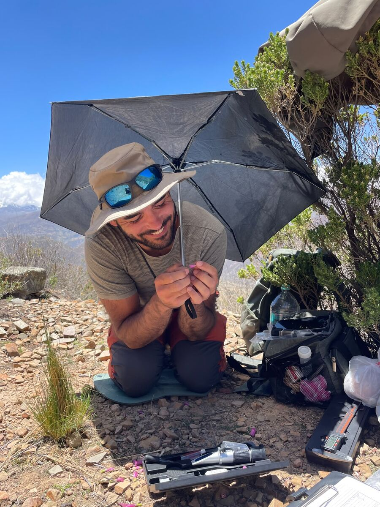
<p class="img-credit">© Andrés Romero Bravo</p>
```
:::
:::

---

## Floral evolution along Andean altitudinal gradients

::: {.grid}
::: {.g-col-12 .g-col-md-4}
```{=html}
<div class="mini-carousel">
  <div>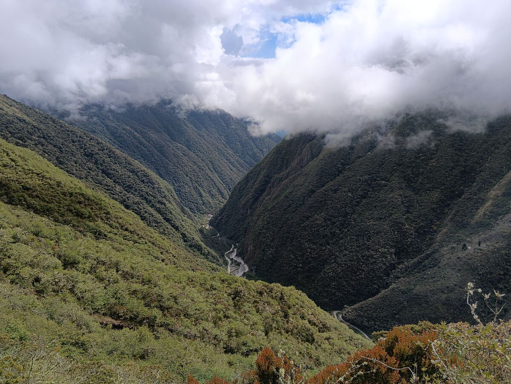</div>
  <div>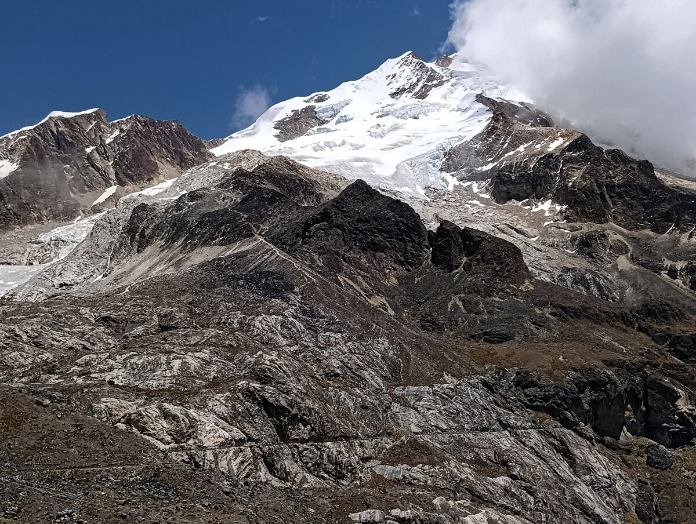</div>
  <div>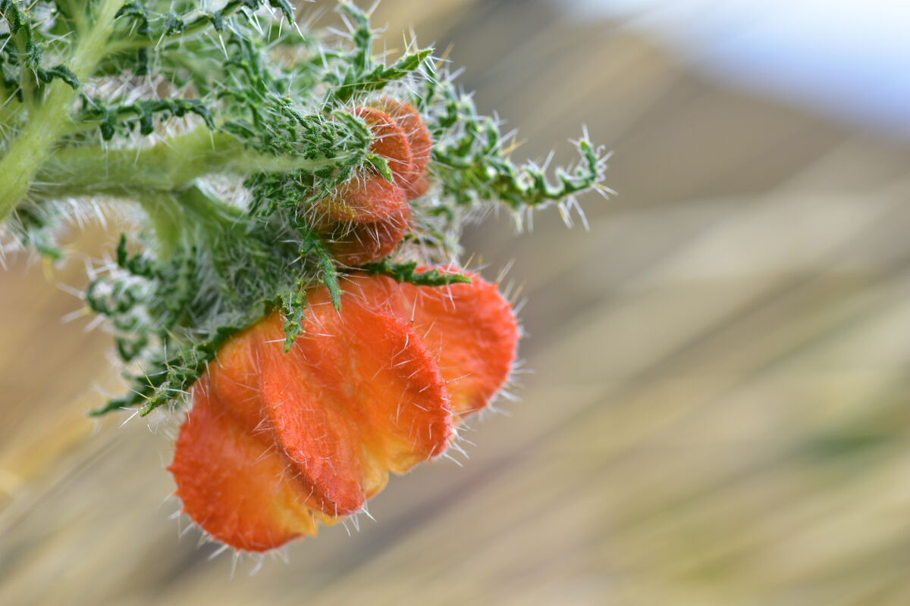</div>
</div>
```
:::
::: {.g-col-12 .g-col-md-8}
*Lund University*

High-altitude mountain ranges offer steep environmental gradients over short distances, making them natural laboratories for studying adaptation. Studying variation in floral phenotypes along altitudinal gradients, I investigate how floral integration and allometry are shaped by changes in abiotic- and pollinator-mediated selection in Andean communities. Knowing how flowering plants respond to changes in their environment will help us understand how climate change and pollinator decline may affect flower evolution over the next decades.
:::
:::

## Floral evolution under novel pollination environments

::: {.grid}
::: {.g-col-12 .g-col-md-4}
```{=html}
<div class="mini-carousel">
  <div>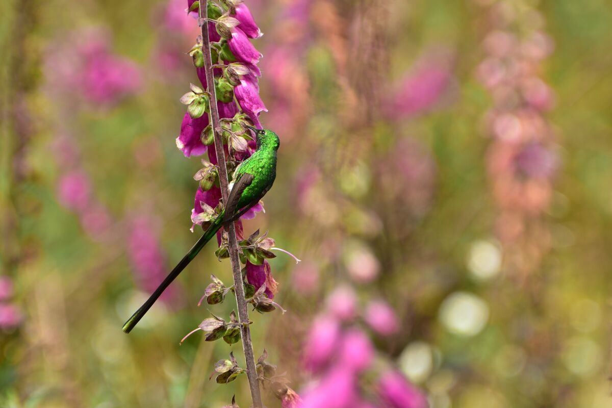</div>
  <div>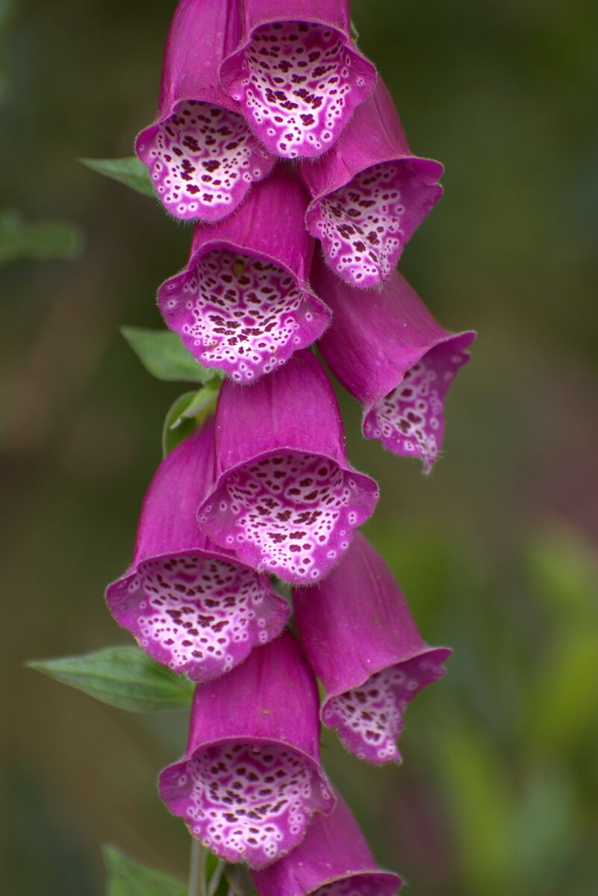</div>
  <div>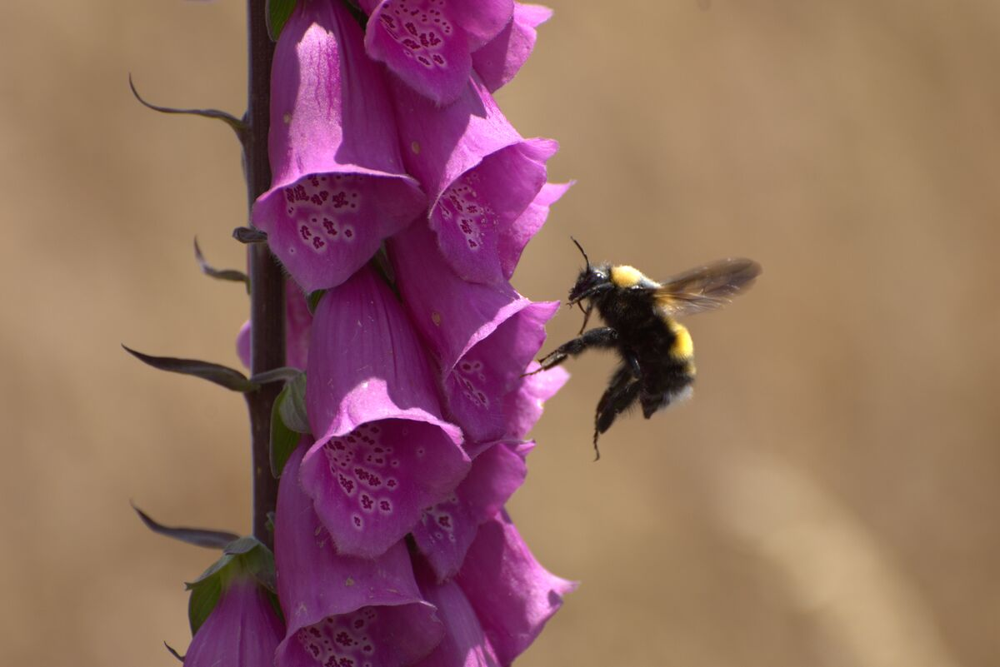</div>
</div>
```
:::
::: {.g-col-12 .g-col-md-8}
*University of Sussex*

Pollinator declines and changes in the distribution of flowering plants are reshaping their selective environment. During my PhD, I explored the plasticity, evolvability and local adaptation of floral traits under novel pollination environments. Using native and naturalised populations of _Digitalis purpurea_, I combined common-garden, transplant and resurrection experiments with genomic and multivariate analyses to show how nectar and floral morphology differ in their evolutionary potential, and how this can affect their evolution when they encounter new pollinators after introduction events.
:::
:::

## Thermal plasticity and rapid evolution under climate change

::: {.grid}
::: {.g-col-12 .g-col-md-4}
```{=html}
<div class="mini-carousel">
  <div>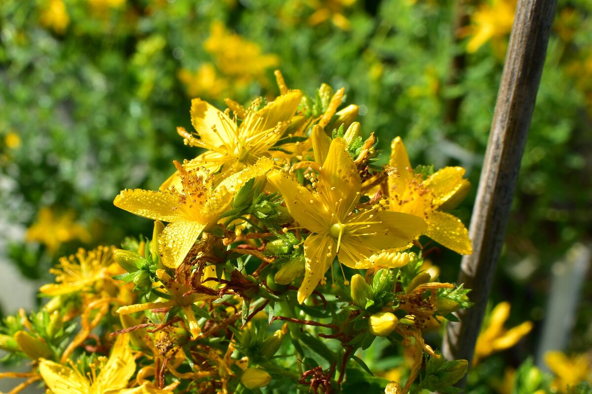</div>
  <div>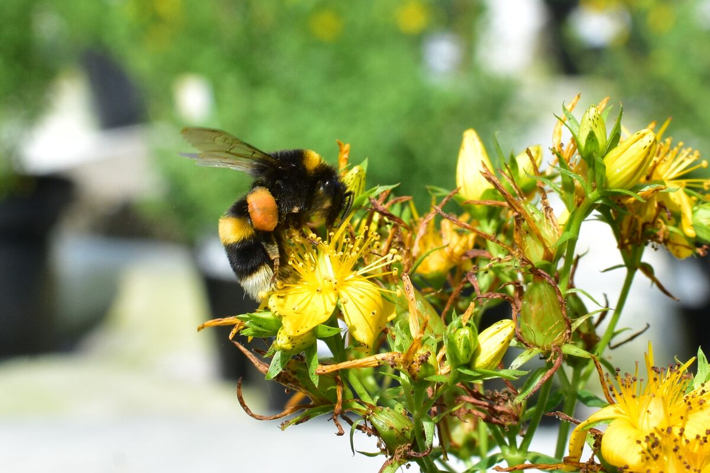</div>
  <div></div>
</div>
```
:::
::: {.g-col-12 .g-col-md-8}
*University of Sussex / University of Helsinki*

Rising temperatures are imposing new selection pressures on plants worldwide, which must adjust their vegetative and reproductive traits to persist. But do plants survive through plasticity, genetic change, or both? Using a resurrection approach, I compare how ancestral and descendant plants cope with increasing temperatures. Combining greenhouse and transplant experiments across the native range of _Hypericum perforatum_, I study thermal plasticity, recent phenotypic divergence and current natural selection on vegetative and floral traits.
:::
:::

## Polyploidy and floral divergence in specialised pollination systems

::: {.grid}
::: {.g-col-12 .g-col-md-4}
```{=html}
<div class="mini-carousel">
  <div>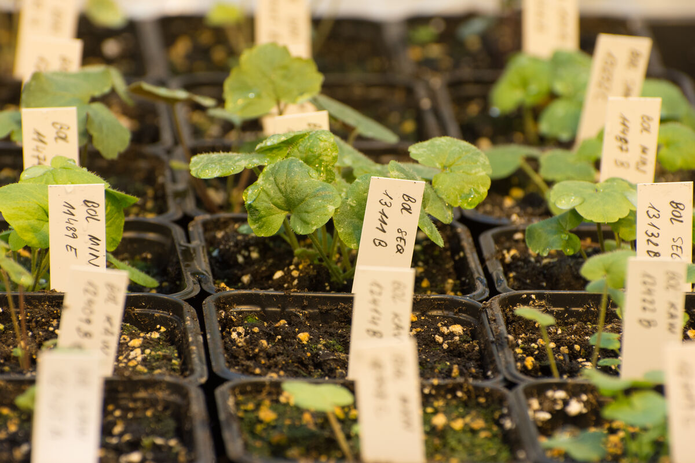</div>
  <div>
    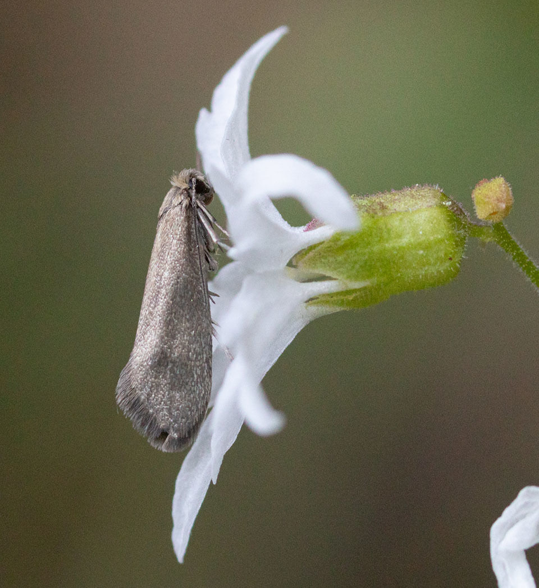
    <p class="img-credit">© Paul G. Johnson, <a href="https://www.inaturalist.org/photos/190564808" target="_blank">iNaturalist</a>, <a href="https://creativecommons.org/licenses/by-nc-sa/4.0/" target="_blank">CC BY-NC-SA</a></p>
  </div>
  <div>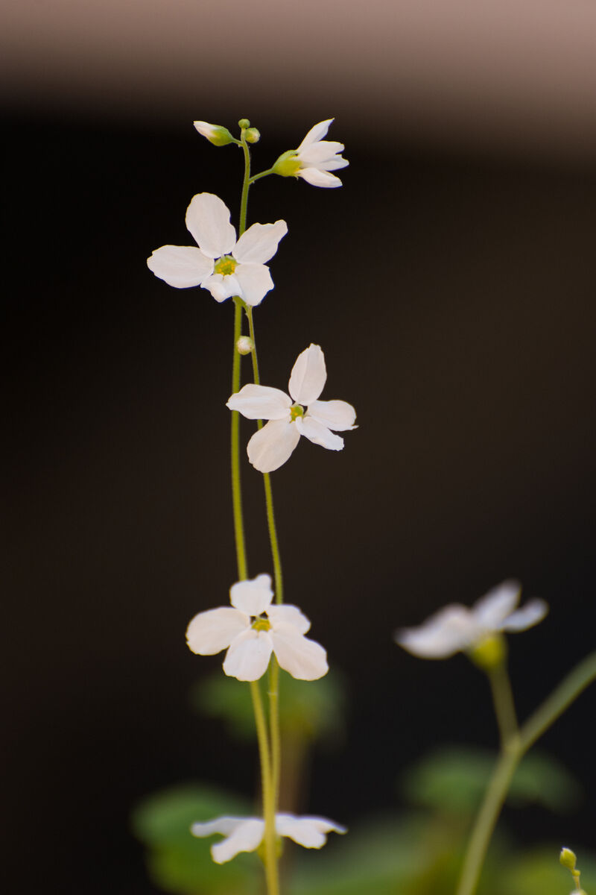</div>
</div>
```
:::
::: {.g-col-12 .g-col-md-8}
*Lund University*

Whole-genome duplication is a major driver of plant diversification. The perennial herb _Lithophragma bolanderi_ comprises diploid, tetraploid and hexaploid populations. This species coevolves with its specialised pollinators, _Greya_ moths, with which it forms a nursery pollination system. As part of this project, I combine range-wide sampling, common-garden and crossing experiments, genomics and field surveys to study how polyploidy shapes floral morphology and plant–pollinator interactions. Ongoing work explores how polyploids overcome reproductive isolation from their ancestors and establish despite the minority cytotype disadvantage.
:::
:::

---

See my [publications](publications.qmd) for more.

```{=html}
<!-- Lightbox overlay -->
<div id="lightbox" class="lightbox-overlay" onclick="this.style.display='none'">
  
</div>

<link rel="stylesheet" href="https://cdnjs.cloudflare.com/ajax/libs/slick-carousel/1.8.1/slick.min.css"/>
<link rel="stylesheet" href="https://cdnjs.cloudflare.com/ajax/libs/slick-carousel/1.8.1/slick-theme.min.css"/>
<script src="https://cdnjs.cloudflare.com/ajax/libs/jquery/3.3.1/jquery.min.js"></script>
<script src="https://cdnjs.cloudflare.com/ajax/libs/slick-carousel/1.8.1/slick.min.js"></script>
<script>
$(function(){
  // Default credit for slides that don't have one
  $('.mini-carousel > div').each(function(){
    if ($(this).find('.img-credit').length === 0) {
      $(this).append('<p class="img-credit">© Andrés Romero Bravo</p>');
    }
  });

  // Mini carousels
  $('.mini-carousel').slick({
    autoplay: true,
    autoplaySpeed: 4000,
    arrows: false,
    dots: true,
    fade: true
  });

  // Lightbox: click a carousel or intro image to view it full screen
  $(document).on('click', '.mini-carousel img, .intro-img', function(){
    $('#lightbox-img').attr('src', $(this).attr('src'));
    $('#lightbox').fadeIn();
  });
});
</script>
```